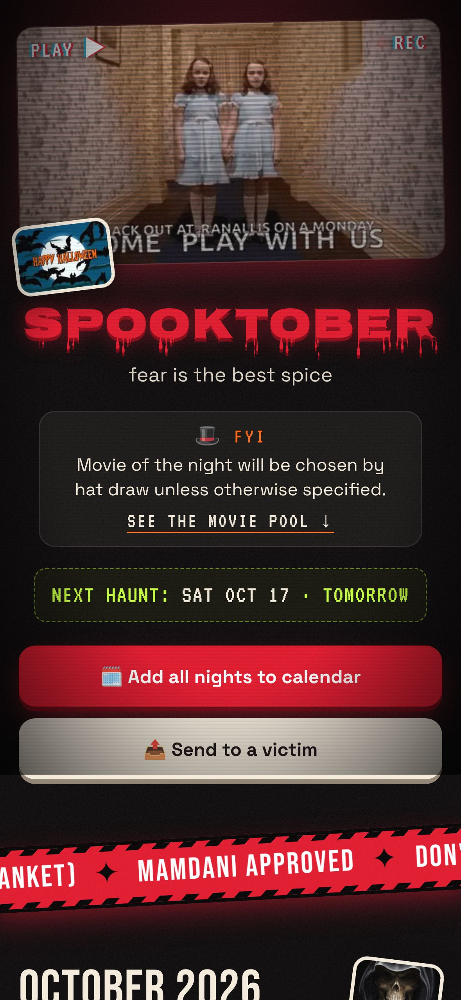
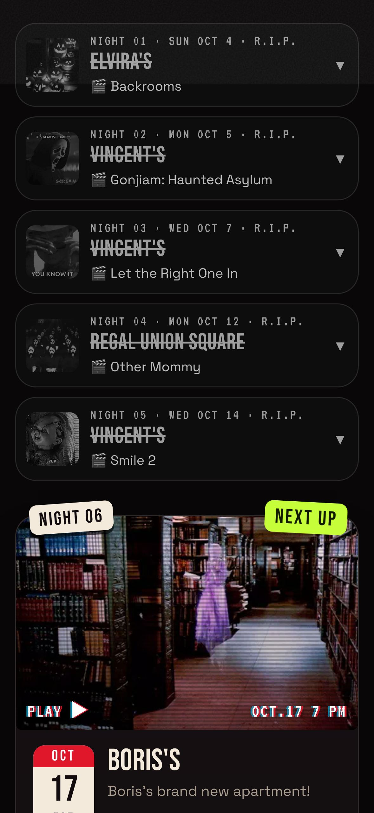
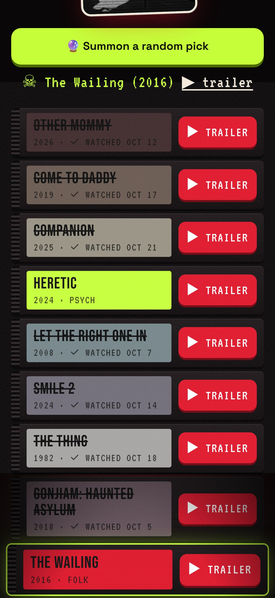
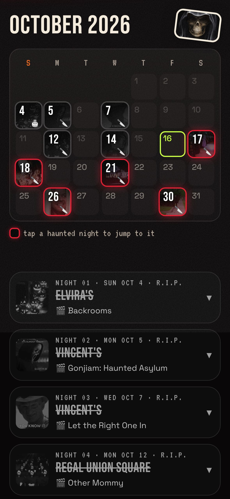
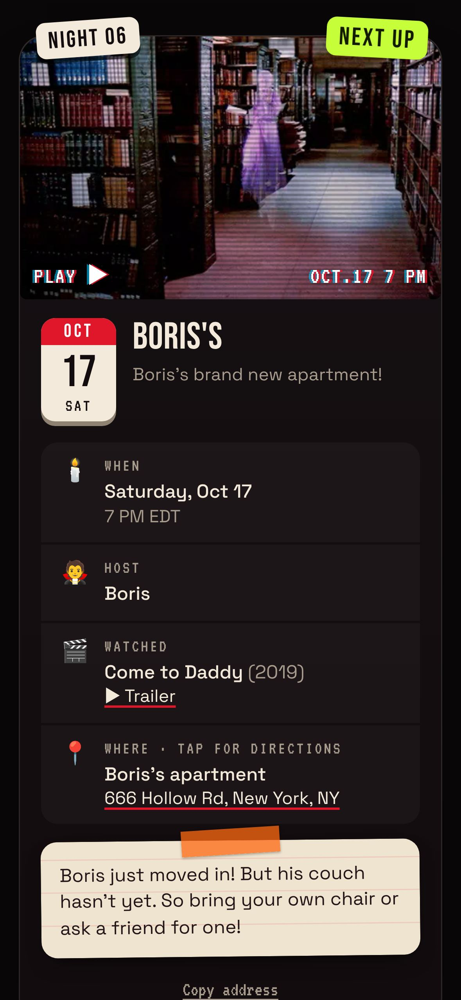
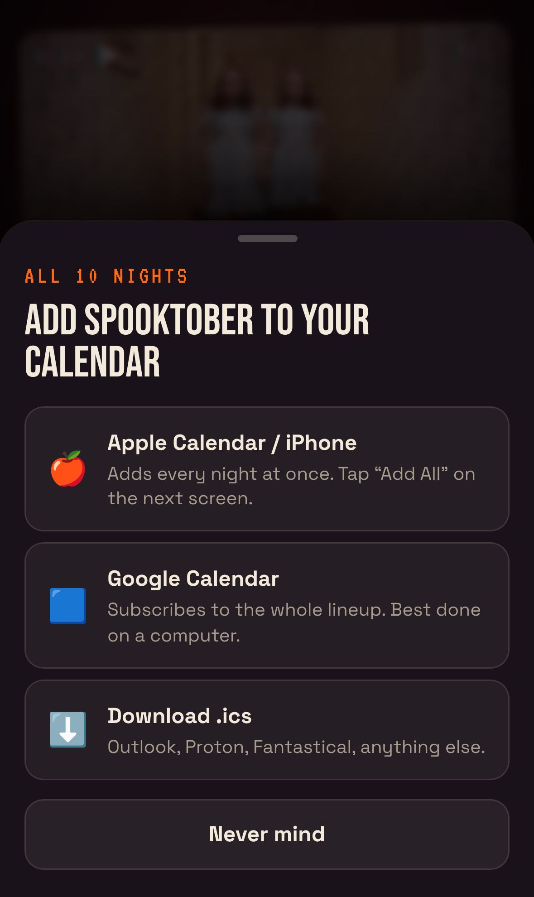
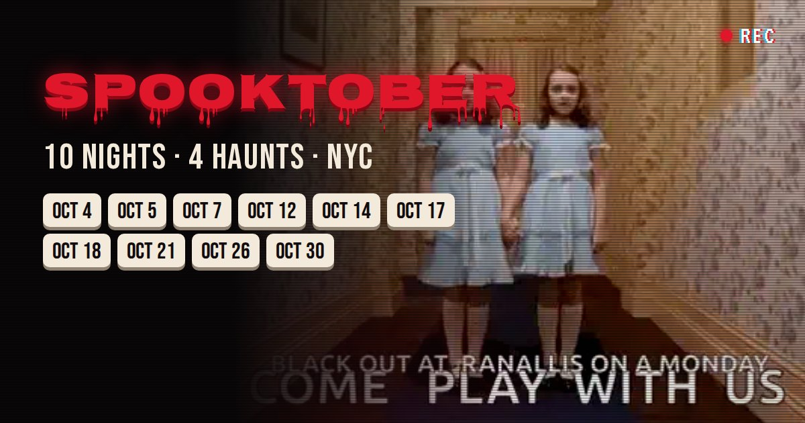

# SPOOKTOBER 🔪

*fear is the best spice*

A one-page invite for a month of horror movie nights: ten nights, four apartments plus a movie theater, one link texted to friends. It ran through October 2026 and is now offline. This repo is the whole thing, with the real names and addresses swapped for horror-icon stand-ins (Elvira, Vincent, Boris).

<p align="center">
  
  
  
</p>

## Why

[Partiful](https://partiful.com) is great for one party. This wasn't one party. It was a horror movie night roughly twice a week for a month, rotating between friends' apartments, with one night at a theater. No event app handled "one invite, many dates, many places".

What was actually needed was smaller than an event app. No RSVPs, no accounts, no notifications. Just:

- an October calendar showing which nights are on,
- each night's time, host, a tap-for-directions address and any house rules ("bring your own chair"),
- a way to put the nights in your calendar,
- the pool of movies, since each night's movie was pulled from a hat,
- a nice preview card when the link gets texted,
- and it had to look good on a phone, with GIFs everywhere.

## How it was made

The site was built and run entirely from a phone, in conversation with [Claude Code](https://claude.com/claude-code) (on the web, through the Claude app). There was no laptop in the loop.

```
 phone (Claude app)          Claude Code (cloud container)          GitHub            Cloudflare
 ─────────────────           ─────────────────────────────          ──────            ──────────
 "we watched Smile 2   ──▶   edit event.config.mjs            ──▶   push to main ──▶  Workers Builds:
  last night"                build + headless-Chrome check                           node build.mjs
                             at iPhone size                                           wrangler deploy
                                                                                          │
 text the link to friends ◀──────────────────── live at <domain>/boo in ~1 minute ◀───┘
```

- **The first version** came from a single long message describing what was wanted. Claude Code built a static site, picked and downloaded the GIFs, generated the preview-card image, and checked the layout in a headless Chromium at iPhone size before sending screenshots back to the phone.
- **Every change after that** was a chat message: "change the Monday times", "make Boris's GIF a haunted bookcase", "we watched The Thing on the 18th". Claude edited the config or code, re-checked it in the browser, pushed to `main`, and confirmed on the live URL once Cloudflare had redeployed.
- **Hosting moved twice.** GitHub Pages was the first plan, but Pages needs a paid plan for a private repo. Cloudflare Workers static assets worked with the repo kept private, connected through Cloudflare's GitHub integration. A Worker route serves only one path on an existing domain (`<domain>/boo`), and the rest of the domain stays on whatever already serves it.
- **The page got simpler over the month.** Feedback from the phone mostly removed things: per-night buttons, section labels, the footer fine print, a calendar "subscribe" link that silently does nothing on Android. It also added a few: a birthday cake for Boris, a hat-draw note, past nights collapsing into grey rows so the next night is always near the top.

The commit history is the real build log, from the first placeholder version through each change made from the phone (with names and addresses scrubbed).

## What's on the page

<p align="center">
  
  
  
</p>

- **October calendar.** Event days glow red with that night's GIF. Tap one to jump to its card. Past days go grey.
- **Night cards.** Time with timezone, host, the movie watched, and an address that opens Apple Maps on iPhone and Google Maps elsewhere. Host notes sit on a taped index card. The next night gets a "NEXT UP" badge and the hero shows a countdown.
- **Past nights** collapse to a one-line grey row (date, place, movie). Tap to expand the full card in black and white.
- **Add all nights to your calendar.** Real `.ics` files served as `text/calendar`, so iPhones offer "Add All". Google Calendar gets a subscribe link. Times are converted to UTC from New York time at build time.
- **Movie pool** as a VHS rental shelf. Each movie has a trailer button (official trailers only). Watched movies are crossed off with the date, and "Summon a random pick" only draws from the rest.
- **Preview card.** Open Graph tags plus a 1200×630 image, so iMessage, WhatsApp and Discord show the title and dates when the link is texted.

<p align="center">
  
</p>

## How it works

It's a static site with a tiny zero-dependency build step:

| File | What it does |
|---|---|
| `event.config.mjs` | **Everything you edit.** Title, timezone, venues, nights, movie pool. |
| `build.mjs` | Fills the HTML template, inlines the data as JSON, writes one `.ics` per night plus `all.ics`, and outputs to `dist/<path>/`. Plain Node, no packages. |
| `site/` | The page: `index.html`, `styles.css`, `app.js`, self-hosted fonts, GIFs as animated WebP (~2 MB total, lazy-loaded). |
| `site/_headers` | Makes Cloudflare serve `.ics` as `text/calendar` (iPhones need this for "Add to Calendar"). |
| `wrangler.jsonc` | Cloudflare Workers static-assets config, routed to one path on a domain. |
| `scripts/og.mjs` | Renders the preview-card image and icons from `site/og.html` with Playwright. |

The build step exists because some things can't be done in browser JavaScript. Link-preview crawlers never run JS, so the preview tags need absolute URLs in the HTML. iPhones only reliably add events from real `.ics` files. Calendar times are fixed to UTC once, so nobody ends up an hour off.

### Edit the event

In `event.config.mjs`:

- `venues`: each place's name, address, host and standing notes.
- `nights`: one line per night: date, start time, venue (`at`) and a GIF. Optional `end`, `tagline`, `notes`, `sticker` (a GIF stuck on the card's corner) and `calIcon` (calendar emoji, default 🔪).
- `movies`: title, year, tag and a YouTube `trailer`. Add `watched: "oct-04"` to cross one off, or `booked: "Oct 12 · 4DX"` to keep it out of the hat draw.

### Run locally

```sh
npm run dev     # builds and serves http://localhost:8080/boo/
```

Any Node 18+ works. No `npm install` needed.

### Deploy on Cloudflare

1. Set `siteUrl` in `event.config.mjs` and the `routes` in `wrangler.jsonc` to your domain and path.
2. In the Cloudflare dashboard: **Workers & Pages → Create → Import a repository**, then pick this repo. Leave the root directory empty.
3. Build command `node build.mjs`, deploy command `npx wrangler deploy`.

Every push to `main` redeploys. Any other static host works too: serve `dist/`, and make sure `.ics` is served as `text/calendar`.

## Credits

- Built with [Claude Code](https://claude.com/claude-code), from a phone.
- GIFs via [Tenor](https://tenor.com). Trailer links go to the studios' and distributors' official YouTube uploads.
- Fonts: Nosifer, Bebas Neue, VT323 and Space Grotesk (Google Fonts, self-hosted).
